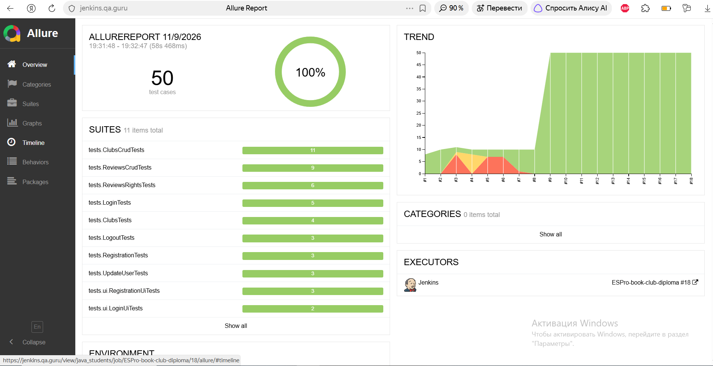
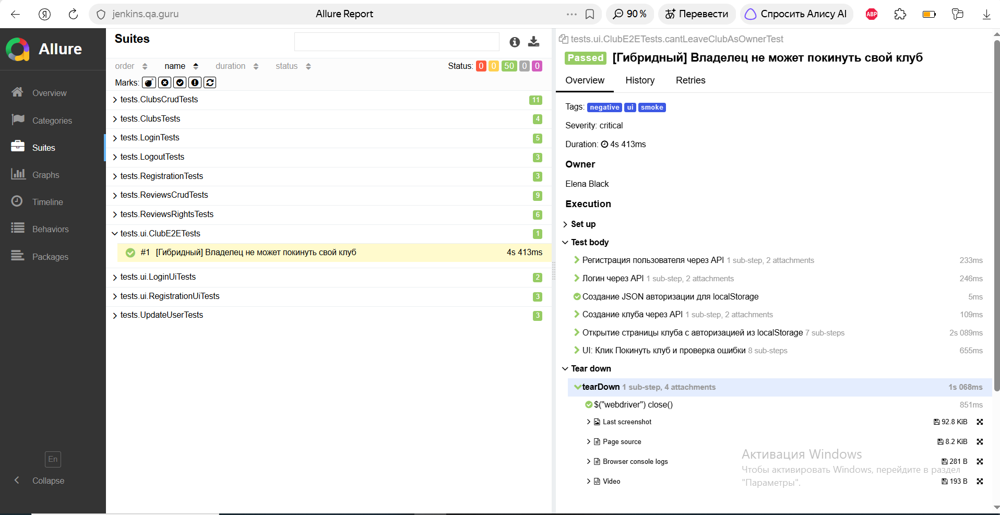
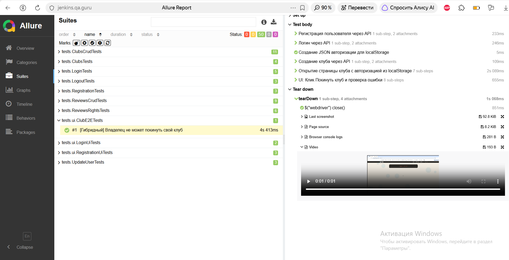
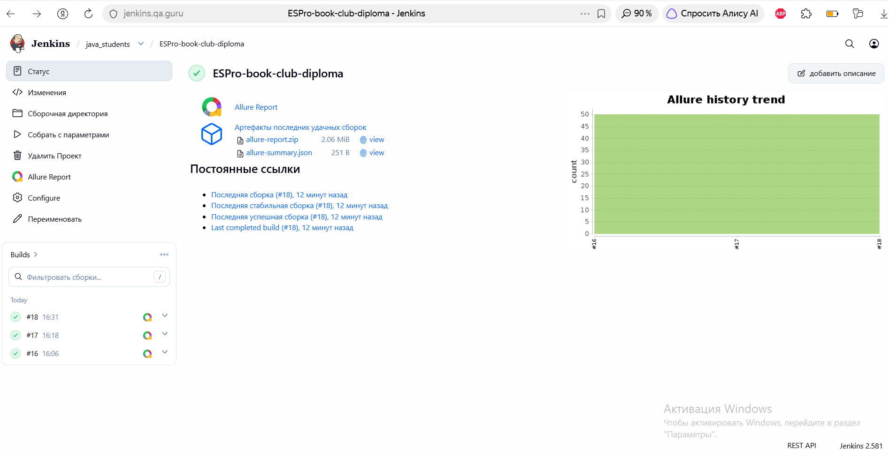

# Book Club Automation (Дипломный проект QA.GURU)

Комплексный фреймворк для автоматизации тестирования учебного сервиса **Book Club** (`book-club.qa.guru`).
Проект представляет собой единый тестируемый контур, объединяющий **Web UI** и **API** тесты.

> **Mobile-тесты:** В соответствии с требованиями к диплому, мобильные автотесты (Appium) вынесены в отдельный независимый репозиторий.
> 🔗 [qa-guru-wikipedia-mobile](https://github.com/ESProshina/qa-guru-wikipedia-mobile)

## 🛠 Стек технологий
* **Java 21**
* **Selenide** (UI-автоматизация)
* **REST Assured** (API-тестирование)
* **JUnit 5** (тестовый фреймворк)
* **Gradle** (сборка проекта)
* **Allure Report** (отчетность и вложения)
* **Jenkins + Selenoid** (CI/CD)

## 🚀 Реализованные сценарии (Покрытие)
В проекте реализовано **50 автотестов**, покрывающих ключевые бизнес-процессы сервиса:
* **API-тесты:** Авторизация, регистрация, CRUD-операции с клубами и отзывами, проверка прав доступа (403 Forbidden), валидация данных.
* **UI-тесты:** Логин, регистрация, проверка ошибок.
* **Сквозной E2E-тест:** Создание клуба через API, авторизация в UI через Local Storage и проверка прав в интерфейсе.

## 📊 CI/CD и Отчетность
* Настроен Jenkins Pipeline с запуском тестов в облачном **Selenoid**.
* В Allure Report прикрепляются все необходимые артефакты: **скриншоты**, **Page Source**, **логи браузера** и **видеозапись** прохождения каждого UI-теста (благодаря встроенным возможностям Selenoid).
* Настроена интеграция с **Telegram** (через `allure-notifications`). *Примечание: в учебном CI-окружении QA.GURU отправка сообщений ограничена настройками корпоративного прокси, однако пайплайн полностью сконфигурирован.*

## 📸 Скриншоты

### 1. Общий вид Allure Report (100% Passed)

### 2. Детализация API-теста (Логи запросов и ответов)

### 3. Сквозной E2E-тест (UI + API)

### 4. Видеозапись теста (Selenoid)
*(Скриншот встроенного плеера с видеозаписью выполнения теста)*

### 5. Jenkins Job

## 📋 Документация
* [Тест-план (Manual & Automated)](TEST_PLAN.md)

---
**Автор:** Елена Прошина (QA Automation Engineer)