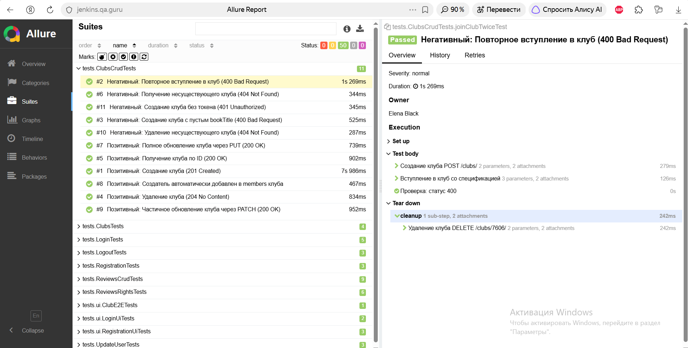
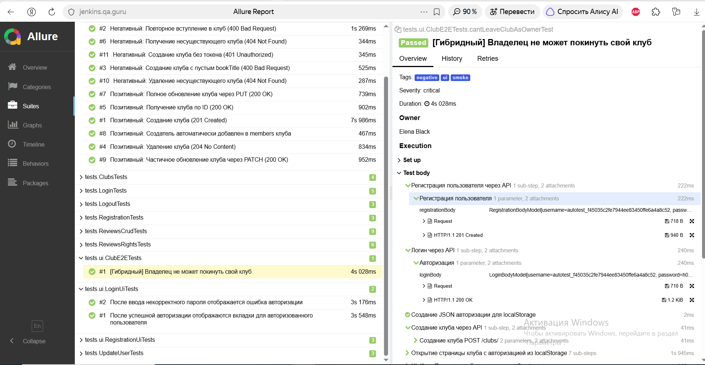
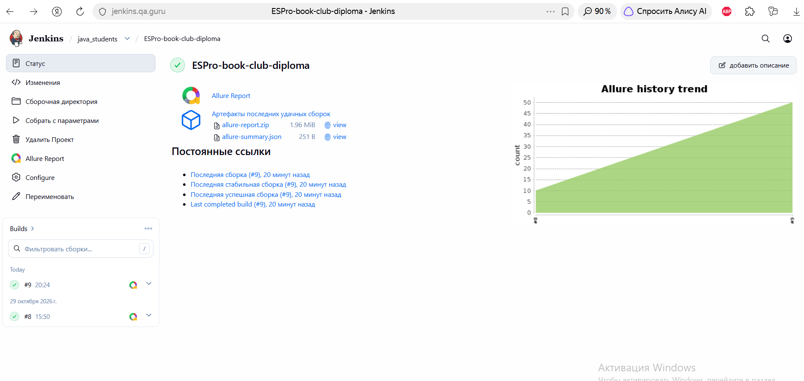

# Book Club Automation (Дипломный проект QA.GURU)

https://jenkins.qa.guru/view/java_students/job/ESPro-book-club-diploma/
https://jenkins.qa.guru/view/java_students/job/ESPro-book-club-diploma/allure/

Комплексный фреймворк для автоматизации тестирования учебного сервиса **Book Club** (`book-club.qa.guru`).
Проект представляет собой единый тестируемый контур, объединяющий **Web UI** и **API** тесты.

> **Mobile-тесты:** В соответствии с требованиями к диплому, мобильные автотесты (Appium) вынесены в отдельный независимый репозиторий:
> 🔗 [Ссылка на репозиторий мобильных тестов](https://github.com/ESProshina/qa-guru-mobile-wikipedia) *(замени на свою реальную ссылку)*

## 🛠 Стек технологий
* **Java 21**
* **Selenide** (UI-автоматизация)
* **REST Assured** (API-тестирование)
* **JUnit 5** (тестовый фреймворк)
* **Gradle** (сборка проекта)
* **Allure Report** (отчетность и вложения)
* **Jenkins + Selenoid** (CI/CD)
* **Owner** (управление конфигурациями)
* **Jackson** (сериализация/десериализация JSON)

## 🚀 Реализованные сценарии (Покрытие)

В проекте реализовано **50 автотестов** (API + UI), покрывающих ключевые бизнес-процессы сервиса:

### 1. API-тесты (44 теста)
* **Авторизация и безопасность:** Успешный логин, неверный пароль, пустые поля, разлогин (с валидным и невалидным токеном).
* **Пользователи:** Успешная регистрация, валидация полей, обновление профиля.
* **Клубы (CRUD):** Создание, получение списка, получение по ID, обновление (PUT, PATCH), удаление. Проверка пагинации и структуры ответа.
* **Отзывы (CRUD):** Создание, обновление и удаление отзывов.
* **Права доступа (Security):** Проверка, что чужой пользователь не может редактировать или удалять отзыв (403 Forbidden), а также проверка автоматического добавления создателя в участники клуба.

### 2. UI-тесты (6 тестов)
* **Регистрация и Логин через UI:** Проверка отображения ошибок при неверном пароле и несовпадении паролей.
* **E2E-тест (Сквозной сценарий):**
    1. Создание пользователя и клуба через **API**.
    2. Авторизация в **UI** через Local Storage.
    3. Проверка в интерфейсе, что владелец клуба не может его покинуть (отображается ошибка).

## 📊 CI/CD и Отчетность
* Настроен Jenkins Pipeline. Тесты запускаются удаленно в **Selenoid** (браузер Chrome).
* Для UI-тестов в Allure прикрепляются артефакты: скриншоты, HTML-код страницы, логи браузера.
* Для API-тестов настроен `AllureRestAssured`, который логирует все запросы и ответы в отчет.
* Настроены уведомления в **Telegram** (Allure Notifications).

## 💻 Запуск тестов локально
```bash
./gradlew clean test

Для запуска только API-тестов:

bash
./gradlew test --tests "tests.*Tests" -x testUi
📸 Скриншоты
1. Общий вид Allure Report (100% Passed)

https://images/allure_1.png

2. Детализация API-теста (Логи запросов и ответов)
(Вставь скриншот любого API-теста, где видны вложения с Request/Response)
https://images/allure_2.png

3. Сквозной E2E-тест (UI + API)

https://images/allure_3.png

4. Jenkins Job
(Вставь скриншот страницы джобы в Jenkins с графиком)
https://images/jenkins_job.png

Автор: Елена Прошина (QA Automation Engineer)